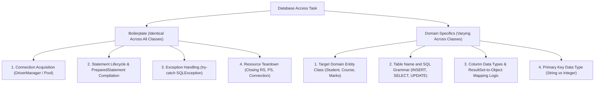

# TASK A3: DISCOVER THE DATA-ACCESS DESIGN PATTERN (5 MARKS)

## Context
A student project contains three separate database interaction classes: `StudentDB`, `CourseDB`, and `MarksDB`. Each class independently manages connections, builds raw SQL query strings, dispatches JDBC statements, parses `ResultSet` columns, and closes resources.

---

## A3.1 – Identify the Common Pattern (2 Marks)

### Systematic Comparison of Repeated vs Differing Code Elements



#### Detailed Breakdown
1. **Repeated Boilerplate Steps (Common across `StudentDB`, `CourseDB`, `MarksDB`):**
   * Acquiring a `Connection` via `DriverManager.getConnection()`.
   * Preparing the parameterized SQL statement with `con.prepareStatement(sql)`.
   * Executing the statement (`executeQuery()` or `executeUpdate()`).
   * Iterating through the cursor with `while(rs.next())`.
   * Catching `SQLException` and managing logging or transaction rollbacks.
   * Ensuring deterministic cleanup via try-with-resources.
2. **Differing Domain Elements (Unique per entity):**
   * The SQL statement string (table name, column names, relational constraints).
   * The number and data types of bind parameters (`ps.setString`, `ps.setInt`, `ps.setDouble`).
   * The transformation logic converting raw `ResultSet` columns into domain entity objects (`mapRowToEntity`).
   * Primary key type: `String` (Register Number) for Student vs `String` (Course Code) for Course vs `Integer` (Marks ID) for Marks.

---

## A3.2 – Design a Generic Data-Access Interface (2 Marks)

### Generic Interface Definition
```java
public interface Dao<T, K> {
    boolean insert(T entity);
    Optional<T> findById(K id);
    List<T> findAll();
    boolean update(T entity);
    boolean delete(K id);
}
```

### Implementation Architecture: `StudentDao`
`StudentDao` implements `Dao<Student, String>`:
* Type parameter `T` is bound to the domain entity `Student`.
* Type parameter `K` is bound to the primary key type `String` (the student's register number).
* Database specifics (table name `student`, column names `reg_no`, `name`, `dept`, `year`, `cgpa`) and row mapping (`mapRowToStudent`) are encapsulated entirely inside `StudentDao`.

---

## A3.3 – Map Objects to Tables (1 Mark)

### Relational Schema Mapping Table
| Java Entity Attribute (`Student.java`) | Database Table Column (`student`) | SQL Data Type | Nullable? | Key / Constraint Description |
| :--- | :--- | :--- | :--- | :--- |
| `private String regNo;` | `reg_no` | `VARCHAR(20)` | **NO** | **Primary Key** (Unique student identifier) |
| `private String name;` | `name` | `VARCHAR(100)` | **NO** | Student full name |
| `private String dept;` | `dept` | `VARCHAR(50)` | **NO** | Academic department code (e.g. CSE, IT) |
| `private int year;` | `year` | `INT` | **NO** | Current academic year (1 to 4) |
| `private double cgpa;` | `cgpa` | `DOUBLE` | **NO** | Cumulative Grade Point Average (0.00–10.00) |

---

## Alternative Concept and Complexity Analysis: SQL in Service/GUI Classes vs DAO Pattern

### The Monolithic Alternative (SQL Written Directly in GUI / Service Layer)
In the anti-pattern architecture, database code is embedded directly inside JavaFX/Swing UI event handlers or service methods:
```java
// Anti-Pattern: SQL embedded directly inside GUI button click event
btnSave.setOnAction(e -> {
    Connection c = DriverManager.getConnection(url, user, pass);
    PreparedStatement ps = c.prepareStatement("UPDATE student SET stud_name=? WHERE reg_no=?");
    ps.setString(1, txtName.getText());
    ps.setString(2, txtReg.getText());
    ps.executeUpdate();
    c.close();
});
```

### Architectural Comparison & Maintenance Complexity
| Evaluation Metric | SQL Embedded in GUI / Service Classes | Generic DAO Pattern (`Dao<T, K>`) |
| :--- | :--- | :--- |
| **Number of Points of Change (e.g., when column `name` is renamed to `full_name`)** | **$N$ scattered locations** across all UI buttons, reports, and service controllers throughout the codebase. | **Exactly 1 location** inside `StudentDao.java` (in `mapRowToStudent` and SQL constants). |
| **Coupling Level** | Extremely Tight Coupling ($O(M \times N)$ dependencies between UI and SQL schema). | Low Coupling / High Cohesion (UI depends only on domain model `Student` and interface `Dao<Student, String>`). |
| **Testability & Mocking** | Impossible to unit test UI or business logic without a live running database. | Trivial: Service and UI layers can be unit tested using mock in-memory DAOs. |
| **Runtime Execution Time Cost** | Identical ($O(1)$ network I/O and query execution time). | Identical ($O(1)$ network I/O and query execution time). The DAO interface abstraction is inlined by the JVM JIT compiler with zero measurable overhead. |
| **Runtime Memory / Space Cost** | $O(1)$ auxiliary memory per operation. | $O(1)$ auxiliary memory per operation (negligible single reference to DAO instance). |
| **Cognitive Load & Defect Risk** | High: High likelihood of leaking connections, missing error handling, or SQL syntax regressions. | Minimal: Connection pooling and transaction handling are centralized and standardized. |
