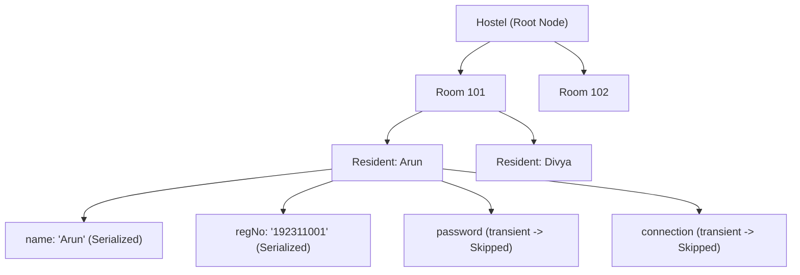

# TASK A4: WHAT SHOULD BE SERIALIZED? (4 MARKS)

## Context
A hostel management program persists its in-memory domain state by serializing a `Hostel` object.
The domain model forms an object graph:
$$\text{Hostel} \longrightarrow \text{List}\langle\text{Room}\rangle \longrightarrow \text{List}\langle\text{Resident}\rangle$$
Each `Resident` possesses: `name`, `regNo`, `password`, and a reference to an active `java.sql.Connection`.

---

## A4.1 – Decide What to Persist (2 Marks)

### Fields That MUST Be Marked `transient`
1. **`private transient Connection connection;`**
   * *Technical Justification:* A `Connection` instance represents an active, live operating system network socket descriptor connected to a remote MySQL daemon process. Sockets depend on transient OS kernel structures, TCP session handshakes, process IDs, and authentication tokens that cannot be preserved across process restarts or deserialized on another physical machine. Attempting to serialize an active `Connection` immediately throws `java.io.NotSerializableException`.
2. **`private transient String password;`**
   * *Technical Justification:* Security and credential exposure. Java serialization stores object state as a plain binary stream without default encryption. Writing plaintext passwords to disk files exposes them to unauthorized inspection, extraction, and privilege escalation vulnerabilities. Credentials must never be serialized; instead, passwords must be omitted or replaced with cryptographic salted password hashes.

### What Happens to the Object Graph During Serialization?
When `objectOutputStream.writeObject(hostel)` is invoked:
* The JVM executes a **recursive Depth-First Search (DFS) graph traversal** starting at the root `Hostel` object.
* It serializes the `Hostel` metadata, class descriptor, and non-transient primitive fields.
* It follows references to the `List<Room>` collection, traverses into each `Room` node, and subsequently visits each `Resident` object in the room's resident collection.
* Handled Cyclic References: The serialization engine maintains an internal active object registry (identity hash table). If an object has already been serialized elsewhere in the graph, it writes a compact 4-byte back-reference handle instead of duplicating the object data, preventing infinite loops.
* `transient` fields (`connection` and `password`) are skipped during traversal. During subsequent deserialization, reference types marked `transient` are reinitialized to `null`, and primitive types to `0` or `false`.

---

## A4.2 – Plan for Change (2 Marks)

### The Scenario: Adding `phoneNumber` After Data Has Been Saved
A new attribute, `private String phoneNumber;`, is introduced into `Resident` after several hostel state files have already been written to disk.

### What Happens When Reading an Old File?
The behavior is dictated by whether `serialVersionUID` was explicitly declared:

#### Case 1: `serialVersionUID` is NOT Declared (Default JVM Hashing)
* When no explicit UID is declared, the JVM computes a 64-bit SHA-1 hash over the class signature (class name, interfaces, fields, methods, access modifiers).
* Adding `phoneNumber` alters the class signature.
* When reading the old file, the JVM compares the file's recorded `serialVersionUID` ($UID_{\text{old}}$) with the newly recomputed class hash ($UID_{\text{new}}$).
* Because $UID_{\text{old}} \neq UID_{\text{new}}$, the JVM immediately aborts deserialization and throws:
  $$\text{java.io.InvalidClassException: Resident; local class incompatible}$$
* **All existing persistent data files become unreadable and lost!**

#### Case 2: `serialVersionUID` IS Explicitly Declared
* When `private static final long serialVersionUID = 1L;` is explicitly fixed in the class definition, both the serialized stream and the updated class carry the identical UID.
* The JVM recognizes that the class versions are compatible:
  1. All existing attributes (`name`, `regNo`) are successfully deserialized from the stream.
  2. The newly introduced attribute (`phoneNumber`) is initialized to its default value (`null`).
* Deserialization completes smoothly without exceptions, achieving seamless backward compatibility!

---

## Alternative Concept and Complexity Analysis: Java Serialization vs CSV vs JSON

### Architecture Comparison
* **CSV:** Flat delimited text rows. Cannot naturally represent hierarchical 1-to-many relationships (Hostel -> Rooms -> Residents) without denormalizing or creating multiple linked files with foreign keys.
* **JSON (JavaScript Object Notation):** Structured, hierarchical text format (e.g. via Jackson or Gson). Naturally represents nested object graphs (`{ "hostel": "Block A", "rooms": [ { "roomNo": 101, "residents": [...] } ] }`).

### Quantitative and Qualitative Comparison
| Criterion | Java Native Serialization | CSV File | JSON Format (Jackson/Gson) |
| :--- | :--- | :--- | :--- |
| **File Size (n Residents)** | Medium: Contains binary data plus verbose Java class metadata headers. | **Smallest ($O(n)$)**: Ultra-compact, stores only raw values separated by commas. | Medium-Compact: Human-readable text, but contains repeated field keys (`"name":`, `"regNo":`). |
| **Save / Load Time** | Fast for native JVM execution, but relies heavily on reflection. | Fast sequential scanning, but lacks hierarchical nested parsing. | Slightly slower CPU parsing (lexer/tokenizer), but highly optimized in modern JSON libraries. |
| **Handling Added Field (`phoneNumber`)** | **Fragile:** Fails catastrophically (`InvalidClassException`) unless `serialVersionUID` is manually managed. | **Fragile:** Positional tokens shift; existing code reading column 4 receives wrong data. | **Extremely Robust:** Parser automatically maps new key if present, defaults to `null` if absent (`FAIL_ON_UNKNOWN_PROPERTIES=false`). |
| **Interoperability** | **Zero:** Exclusive to Java. Cannot be parsed by Python, C++, Go, or web browsers. | **Universal:** Any language or spreadsheet (Excel) can open CSV. | **Universal Industry Standard:** Seamless interoperability across all programming languages and web APIs. |
| **Human Readability** | Zero (Binary gibberish; difficult to debug or inspect). | High (Plain text rows). | High (Clean, structured, human-readable text). |
