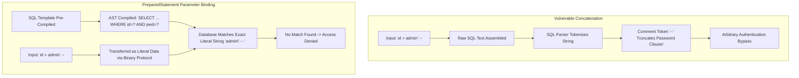

# TASK A5: DESIGN FOR CORRECTNESS AND SAFETY (4 MARKS)

## Context
A campus enterprise application handles financial wallet transfers and administrative authentication.
* Operation 1: Transfer ₹500 from student's hostel wallet to campus canteen wallet.
* Operation 2: Authenticate users against administrative credentials.

---

## A5.1 – Transaction Design (2 Marks)

### Financial Invariant
Money must neither be created out of nothing nor lost into the void:
$$\text{Balance}(\text{HostelWallet}) + \text{Balance}(\text{CanteenWallet}) = \text{Constant}$$
If the server crashes, power drops, or network disconnects between the debit and credit operations, the system must guarantee **Atomicity** and **Consistency** (ACID properties).

---

### Algorithmic Pseudocode (SIMATS Engineering Standard)

```text
ALGORITHM ExecuteWalletTransfer(connection, fromWalletId, toWalletId, transferAmount)
    INPUT:  connection (JDBC Database Connection),
            fromWalletId (String), toWalletId (String),
            transferAmount (Real Number > 0)
    OUTPUT: Boolean (True if transfer committed atomically, False if rolled back)

    VARIABLES:
        oldAutoCommit : Boolean
        sqlDebit, sqlCredit : String
        stmtDebit, stmtCredit : PreparedStatement
        rowsDebited, rowsCredited : Integer

    BEGIN
        IF transferAmount <= 0.0 THEN
            LOG "Invalid transfer amount: Amount must be positive."
            RETURN FALSE
        END IF

        sqlDebit  <- "UPDATE wallet SET balance = balance - ? WHERE wallet_id = ? AND balance >= ?"
        sqlCredit <- "UPDATE wallet SET balance = balance + ? WHERE wallet_id = ?"

        TRY
            // Step 1: Save existing auto-commit mode and enter manual transaction boundary
            oldAutoCommit <- connection.GetAutoCommit()
            connection.SetAutoCommit(FALSE)

            // Step 2: Execute Debit from Source Wallet
            stmtDebit <- connection.PrepareStatement(sqlDebit)
            SetDouble(stmtDebit, 1, transferAmount)
            SetString(stmtDebit, 2, fromWalletId)
            SetDouble(stmtDebit, 3, transferAmount)  // Guard against overdraft
            rowsDebited <- ExecuteUpdate(stmtDebit)

            IF rowsDebited != 1 THEN
                // Insufficient funds or source wallet does not exist
                connection.Rollback()
                LOG "Transfer aborted: Insufficient funds or invalid source wallet."
                RETURN FALSE
            END IF

            // Step 3: Execute Credit to Destination Wallet
            stmtCredit <- connection.PrepareStatement(sqlCredit)
            SetDouble(stmtCredit, 1, transferAmount)
            SetString(stmtCredit, 2, toWalletId)
            rowsCredited <- ExecuteUpdate(stmtCredit)

            IF rowsCredited != 1 THEN
                // Destination wallet does not exist
                connection.Rollback()
                LOG "Transfer aborted: Destination wallet not found."
                RETURN FALSE
            END IF

            // Step 4: Atomic Commit - All updates become permanent together
            connection.Commit()
            LOG "Transaction successfully committed: Rs " + ToString(transferAmount) + " transferred."
            RETURN TRUE

        CATCH SQLException ex
            // Step 5: Rollback on any failure - Restore clean invariant
            TRY
                connection.Rollback()
                LOG "SQLException encountered. Transaction rolled back: " + ex.Message
            CATCH SQLException rollbackEx
                LOG "Critical: Rollback failed: " + rollbackEx.Message
            END TRY
            RETURN FALSE

        FINALLY
            // Step 6: Restore connection auto-commit state
            connection.SetAutoCommit(oldAutoCommit)
        END TRY
    END
```

---

## A5.2 – Injection Analysis & PreparedStatement Redesign (2 Marks)

### Vulnerable Code Analysis
```java
String sql = "SELECT * FROM users WHERE id='" + id + "' AND pwd='" + pwd + "'";
```

### Exploit Demonstration: Abstract Syntax Tree (AST) Manipulation
Suppose an adversarial user submits:
* `id` = `admin' -- `
* `pwd` = `garbage_password`

The resulting SQL string assembled by string concatenation becomes:
```sql
SELECT * FROM users WHERE id='admin' -- ' AND pwd='garbage_password'
```

#### Why the Attack Succeeds:
1. The single quotation mark (`'`) in the input prematurely closes the string literal for `id`.
2. The sequence `-- ` is the standard SQL comment delimiter.
3. The SQL parser ignores all characters from `-- ` to the end of the line, completely stripping the `AND pwd='...'` clause!
4. The database executes:
   ```sql
   SELECT * FROM users WHERE id='admin'
   ```
5. The query returns the administrator's record. The application sees `rs.next() == true` and grants full administrative access without verifying any password!



---

### Secure Redesign Using `PreparedStatement`

```java
public boolean authenticateSecurely(Connection con, String id, String pwd) throws SQLException {
    String sql = "SELECT id, role FROM users WHERE id = ? AND pwd = ?";
    try (PreparedStatement ps = con.prepareStatement(sql)) {
        ps.setString(1, id);
        ps.setString(2, pwd);
        try (ResultSet rs = ps.executeQuery()) {
            return rs.next(); // True only if exact ID and password match
        }
    }
}
```

#### Why `PreparedStatement` Completely Prevents Injection:
1. **Separation of Code and Data:** The SQL command structure is sent to the database engine and compiled into an Abstract Syntax Tree (AST) *before* parameter values are evaluated.
2. **Binary Parameter Transmission:** Parameter values are transferred separately across the wire using JDBC binary parameter packets. They are never parsed as SQL tokens.
3. Quotes, comments (`--`), and semicolons inside the input are treated strictly as string literals, completely neutralizing any code injection.

---

## Alternative Concept and Complexity Analysis: Auto-Commit vs Single Transaction

### The Failure Scenario
Suppose the two wallet updates are executed with default `con.setAutoCommit(true)`:
1. Statement 1 executes: `UPDATE wallet SET balance = balance - 500 WHERE wallet_id = 'W_HOSTEL_101'` -> **Immediately committed to disk!**
2. **System Crash:** Power failure, network interruption, or JVM crash occurs before Statement 2 can run.
3. Statement 2 (`UPDATE wallet SET balance = balance + 500 WHERE wallet_id = 'W_CANTEEN_01'`) **never executes**.

### Outcome & Risk to Data Correctness
* **Data Corruption:** ₹500 has been permanently deducted from the student's wallet, but the canteen wallet never receives it. The money has literally vanished from the ledger.
* **Integrity Violation:** The fundamental financial invariant is broken. Reconciling corrupted balances requires manual database audits and emergency administrative rollbacks.

### Performance & Time Complexity Comparison
| Characteristic | Two Independent Auto-Commit Updates | Single Atomic Transaction (`setAutoCommit(false)`) |
| :--- | :--- | :--- |
| **Number of Disk `fsync()` Flush Cycles** | **2 separate I/O disk flushes** to the database write-ahead redo log (WAL). | **Exactly 1 I/O disk flush** during `con.commit()`. |
| **Execution Latency** | $\approx 2 \times T_{\text{fsync}}$ (e.g., $2 \times 5\text{ ms} = 10\text{ ms}$) | $\approx 1 \times T_{\text{fsync}} + \text{negligible update time} \approx 5.5\text{ ms}$ |
| **Network Round-Trips** | 2 roundtrips with 2 server commit packets | 2 statement packets combined with 1 commit request |
| **ACID Guarantees** | **None:** Vulnerable to partial write corruption. | **Full:** Atomicity, Consistency, Isolation, and Durability guaranteed. |
