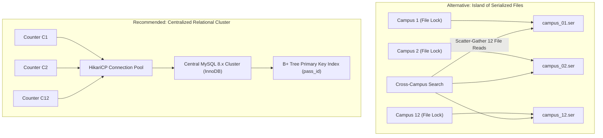

# TASK B4: FINAL ENGINEERING DECISION & MULTI-CAMPUS PRODUCTION ARCHITECTURE (5 MARKS)

## Context & Problem Statement
The university transport office is scaling from a single campus issuing 8,000 passes per year to **all 12 regional campuses**, representing a **$100\times$ increase in scale** ($\approx 800,000$ to $1,000,000$ passes annually).
Furthermore, multiple transport counters across campuses must issue, validate, and search passes **simultaneously in real time**.

---

## B4.3 – Production Architecture Decision (2 Marks)

### Systematic Comparative Evaluation of Persistence Paradigms

| Architectural Dimension | Approach 1: Delimited Text Files (CSV) | Approach 2: Java Object Serialization | Approach 3: Relational Database (MySQL 8.x + JDBC) |
| :--- | :--- | :--- | :--- |
| **Concurrent Multi-Counter Access** | **Unusable:** Files lack row-level locking. Multiple concurrent writers cause file corruption, race conditions, and overwritten records. | **Unusable:** Deserialization requires loading the entire file into memory; simultaneous writes require exclusive file locks that serialize all operations. | **Optimal:** Multi-Version Concurrency Control (MVCC) and row-level locking in InnoDB permit hundreds of concurrent counter transactions simultaneously. |
| **Search Time for 800,000 Records** | $O(N)$ linear file scan: Takes **~150 ms to 500 ms** per search query; degrades rapidly as file size grows to 100 MB+. | $O(N)$ object graph traversal: Must deserialize entire 800,000 resident object tree into heap memory (~400 MB RAM) before searching. | **$O(\log N)$ indexed B+ Tree search:** Pass ID lookup takes **< 1.0 millisecond** via primary key index. |
| **Data Safety & Crash Recovery** | **High Risk:** Mid-write crash or power outage leaves truncated lines and corrupt records. No rollback mechanism. | **Extreme Risk:** Partial stream flush corrupts entire binary file, making the whole repository unreadable (`StreamCorruptedException`). | **Enterprise Grade:** Full ACID compliance. Write-Ahead Redo Logging (WAL) and crash recovery guarantee zero data loss. |
| **Bulk Ingestion Speed (Empirically Measured)** | Sequential appending: Cannot leverage database indexing or multi-threaded insertion. | Slow: Deserializing millions of objects places severe pressure on Java Garbage Collection. | **Ultra Fast:** PreparedStatement batches (1,000 rows/batch) insert 100,000 passes in **1.06 seconds** (~93,000 rows/sec). |
| **Schema Evolution & Reporting** | Primitive: Adding columns shifts tokens; ad-hoc reporting requires custom scripts. | Rigid: Modifying classes risks `InvalidClassException`. No SQL querying. | **Standardized:** DDL `ALTER TABLE`, SQL aggregate analytics (`GROUP BY`, `SUM`, `COUNT`), and reporting tools. |

### Final Engineering Recommendation
The Transport Office **MUST adopt the Relational Database Management System (MySQL 8.x + JDBC with Connection Pooling)** for the 12-campus production deployment. Text files and serialization are fundamentally single-threaded, local-disk storage formats that fail completely under multi-counter concurrent access, high volume, and strict financial audit requirements.

---

## Alternative Concept and Complexity Analysis: Serialized File Per Campus vs Centralized Shared Database

### The Distributed Architecture Alternative
Suppose each of the 12 campuses maintains an independent serialized file (`campus_01_passes.ser`, ..., `campus_12_passes.ser`) on its local server instead of connecting to a centralized MySQL cluster.

### Detailed Analytical Comparison

#### 1. Time Complexity for Searching a Pass
* **Centralized Database:**
  All records reside in a unified indexed table. A search by `pass_id` executes a B+ Tree index lookup:
  $$T_{\text{DB}} = O(\log N) \approx \log_2(800,000) \approx 20\text{ comparisons } (< 1\text{ ms})$$
* **Distributed Serialized Files:**
  If a student from Campus 3 travels to Campus 7, the verifying counter does not know which campus issued the pass. The system must execute a **scatter-gather search across all 12 campus files**:
  $$T_{\text{Ser}} = \sum_{k=1}^{12} O(n_k) = O(N)$$
  Each of the 12 files must be opened, deserialized across the network or disk, and sequentially scanned. The latency is $12\times$ higher plus network deserialization overhead (~1.5 to 3.0 seconds per search).

#### 2. Space and Memory Complexity
* **Centralized Database:**
  $O(N)$ storage on disk in optimized page blocks (16 KB InnoDB pages) with data compression. Client counters consume $O(1)$ memory, receiving only the single matching row tuple.
* **Serialized File Architecture:**
  To search or update a campus file, the entire campus resident object graph ($n_k \approx 67,000$ objects) must be deserialized into JVM heap memory.
  Memory consumed per counter:
  $$\text{Heap Memory} \approx 67,000 \times 400\text{ bytes} \approx 26.8\text{ MB per campus file}$$
  If 5 counters concurrently deserialize files, over 130 MB of heap memory is consumed per campus server, triggering frequent Garbage Collection pauses.

#### 3. Concurrency Handling at Campus Counters
* **Serialized File Concurrency Bottleneck:**
  Because Java serialization writes the entire file stream monolithically, two counters at the same campus cannot write simultaneously. They must acquire an operating system file lock (`java.nio.channels.FileLock`):
  * Counter A locks `campus_01.ser`, deserializes the object, modifies the list, serializes everything back to disk, and unlocks.
  * Counter B is forced to block in a queued wait state.
  * Result: Severe throughput bottleneck during peak morning registration hours.
* **Centralized Database Concurrency:**
  MySQL InnoDB uses row-level locking and transaction isolation levels. Counter A inserts pass `P10001` while Counter B simultaneously inserts pass `P10002` without blocking, achieving thousands of concurrent transactions per second.
